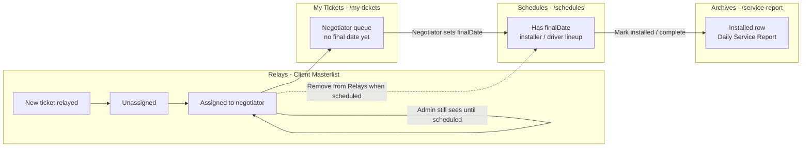

# Relay Ticket Lifecycle — Flow & Implementation Plan

This document describes how a **field / relay ticket** should move through the portal from first relay entry to archives, and what still needs to be aligned in code.

---

## Summary (target behavior)

| Stage | Screen | Who sees it | Leave when |
|-------|--------|-------------|------------|
| 1. New / unassigned | **Relays → Unassigned** | Admin, dispatch | Branch + negotiator assigned |
| 2. Assigned to negotiator | **Relays → Assigned** (admin pool) **or Relays → My Tickets** (negotiator) | Admin sees pool; negotiator sees own queue | Negotiator sets **final date** (scheduled) |
| 3. Scheduled | **Schedules** tab | Branch / installers / dispatch | Job completed (installed / outcome recorded) |
| 4. Installed | **Archives** (`/service-report`) | Branch staff, admin | Permanent record (copy from completed ticket) |

**Rule of thumb:** each tab owns one stage. A ticket should appear on **only one** primary work queue at a time.

---

## End-to-end flow (target)



---

## Stage definitions

### 1. Relays (`ClientMasterlist.tsx`)

**Purpose:** Intake and dispatch — new store relays, assign branch and negotiator.

**Should show:**
- New tickets (status `PENDING`, no negotiator)
- Tickets **assigned** to a negotiator but **not yet scheduled** (no `finalDate` in `acDetails`)

**Should NOT show:**
- Tickets with **`acDetails.finalDate`** set (scheduled) → move to **Schedules**
- `COMPLETED` / `CANCELLED`
- Warranty-only / pending-warranty rows (already excluded via `shouldExcludeFromRelaysTab`)
- Installed tickets (charges paid / outcome installed)

**Relays sub-tabs (target):**

| Tab | Target filter |
|-----|----------------|
| **All Pending** | Pending + Assigned (not scheduled) |
| **Unassigned** | `getRelayStatusLabel` = `Pending` |
| **Assigned** | `Assigned` only, **no** `finalDate` |
| **My Tickets** (on Relays page) | Same as portal **My Tickets**: negotiator’s assigned rows **without** `finalDate` |

**Key fields:**
- `status`: `PENDING` → `ASSIGNED`
- `branchId`, `assignedTo` / `negotiatorId`
- `acDetails.finalDate`: must be **empty** to stay on Relays

---

### 2. My Tickets (`Tickets.tsx` → `/my-tickets`)

**Purpose:** Negotiator’s personal work queue after relay assignment.

**Should show:**
- Tickets assigned to the logged-in negotiator (`assignedTo` / negotiator match)
- Status: Pending or Assigned
- **No** `acDetails.finalDate` yet

**Should NOT show:**
- Tickets once negotiator sets **final date** → **Schedules**
- Completed / installed tickets

**Current helper:** `shouldShowOnMyTickets()` → `getRelayQueueLabel` is `Pending` or `Assigned` only.

**Trigger to leave My Tickets:**
- User sets `finalDate` in edit modal (saved to `acDetails.finalDate` + often `preferredDate`)
- Status may become `SCHEDULED` / `ASSIGNED` with schedule metadata

---

### 3. Schedules (`Tickets.tsx` → `/schedules`)

**Purpose:** Day-of operations — installers, drivers, lineup, final install date.

**Should show:**
- Tickets with **`acDetails.finalDate`** (primary signal)
- Or active schedule statuses: `SCHEDULED`, `IN_PROGRESS`, `ON_THE_WAY`, `RESCHED`, `FOR_APPROVAL`, `SURVEY`, etc.
- Filtered by branch + selected calendar date

**Should NOT show:**
- Pure relay intake (no final date, not yet scheduled)
- Completed rows except as **ghost** entries on the date they were completed (existing behavior)

**Key fields:**
- `acDetails.finalDate` — schedule column date
- `acDetails.scheduleOutcome` — `DONE_INSTALLED`, `DONE_CLEANING`, etc.
- `installerName`, lineup / driver fields

---

### 4. Archives (`DailyServiceReport.tsx` → `/service-report`)

**Purpose:** Permanent installed job record (control number, customer, installer, amounts).

**Should show:**
- Row created when ticket is **installed / completed**
- Source: `POST /v1/service-reports` (daily service report / archive)

**Trigger to enter Archives:**
- Schedule marked installed (`DONE_INSTALLED` or `qualifiesForInstallComplete`)
- `shouldArchiveCompletedSchedule()` → `postTicketArchiveReport()` / `syncMissingTicketArchives()`
- Backend: `TicketService.syncWarrantyRegistrations()` can also backfill archives from completed field tickets

**Archives is a copy** — original ticket may remain in DB as `COMPLETED`; archive row is the branch’s operational record.

---

## Status & data model

### `getRelayStatusLabel` (Relays board)

Used in `ClientMasterlist.tsx`:

```
Pending     → no assignee, collection unpaid, etc.
Assigned    → ASSIGNED or has assignedTo, no finalDate
Scheduled   → acDetails.finalDate + (branchId or assignedTo)
Installed   → COMPLETED or installationCharges > 0
Cancelled   → CANCELLED
```

### `getRelayQueueLabel` (Schedules / My Tickets)

Mirrors relay board logic in `Tickets.tsx` for consistent queue labels.

### `acDetails` JSON (important keys)

| Key | Meaning |
|-----|---------|
| `finalDate` | Negotiator’s scheduled install date — **moves ticket to Schedules**. Single source of truth for "where this ticket is now"; editable at any time (including past dates), and moving it always relocates the ticket in place — no duplicate/ghost row is left on the old date. |
| `relayedDate` | When store relayed the job |
| `scheduleOutcome` | Installed / cleaning / survey result |
| `previousScheduleDates` | **Completed-job** ghost history only (drives the muted row on the date a job was actually installed, if viewed from a different day). Never written on a reschedule — resched ghosts use their own keys below so a date can't mean both "completed here" and "rescheduled from here". |
| `rescheduleHistoryDates` | Dates a ticket was **RESCHED away from** — each renders an italic RESCHED ghost row on that date while the active row lives on `finalDate`. Written by the portal (Edit Ticket / status picker) and by the backend on any RESCHED save that changes the date; the backend carries it over when a save replaces `acDetails`, so a stale client can't wipe it. A plain Final Date edit (not RESCHED) still moves the ticket in place with no ghost. |
| `rescheduleSnapshots` | `{ "<old date>": { installerName, driverName, serviceVehicle, capturedAt } }` — the crew dispatched on each date in `rescheduleHistoryDates`, frozen at reschedule time (first capture wins). The ghost row displays this instead of the live fields, so reassigning the active row's installer/driver doesn't rewrite the old day. A ghost with a snapshot also survives the ticket later being completed/cancelled. |
| `rescheduledTo` | Cosmetic "Moved to &lt;date&gt;" label on the ghost row only — not used for date matching. |

---

## Current behavior vs target (gaps)

| Area | Current | Target | Action |
|------|---------|--------|--------|
| Relays **Assigned** tab | Assigned only ✓ | Same | None |
| Relays **My Tickets** tab | Shows **Scheduled** too | Only Pending + Assigned (no `finalDate`) | **Done** — exclude on `finalDate`, negotiator filter |
| Relays **All / Assigned** pool | Scheduled can still count if mis-labeled | Hide any ticket with `finalDate` | **Done** — `shouldExcludeFromRelaysTab` |
| Portal **My Tickets** | `shouldShowOnMyTickets` ✓ | Same | Verify negotiator match on `assignedTo` |
| **Schedules** | Shows `finalDate` + active statuses ✓ | Same | None |
| **Archives** | Backfill on complete + sync job | Auto on install | Ensure install path always calls `notifyArchiveUpdated` / `postTicketArchiveReport` |

---

## Implementation plan

### Phase 1 — Relays exit when scheduled (portal)

**File:** `src/pages/ClientMasterlist.tsx`

1. Extend `shouldExcludeFromRelaysTab` (or add `shouldStayOnRelaysTab`):
   ```ts
   // Leave Relays once negotiator scheduled
   if (parseAcDetails(ticket).finalDate?.trim()) return true
   if (getRelayStatusLabel(ticket) === 'Scheduled') return true
   ```

2. Update **Relays → My Tickets** tab filter:
   - Remove `Scheduled` from allowed `statusLabel` values
   - Optionally require `assignedTo === user.id` for non-admin

3. Update tab counts (`relayTabCounts`) to match the same rules.

**Acceptance:**
- Set `finalDate` on a ticket → it disappears from Relays (all sub-tabs) within one refresh
- Ticket appears on Schedules for that date

---

### Phase 2 — My Tickets entry on assign (portal)

**Files:** `ClientMasterlist.tsx` (assign save), `Tickets.tsx`

1. On relay assign (`handleDrawerActionSave`):
   - Set `assignedTo`, `negotiatorId`, `branchId`, `status: ASSIGNED`
   - Clear `acDetails.finalDate` if re-assigning an old row

2. On `/my-tickets`:
   - Confirm `shouldShowOnMyTickets` excludes `finalDate` (already does via `getRelayQueueLabel`)
   - Filter by negotiator: `assignedTo === user.id` (or negotiator id fields)

**Acceptance:**
- Admin assigns ticket to Jane → Jane sees it under **My Tickets**
- Jane does not see other negotiators’ assigned tickets (unless admin)

---

### Phase 3 — Schedules handoff (portal)

**File:** `src/pages/Tickets.tsx`

1. When negotiator saves `finalDate` in My Tickets edit:
   - Persist `acDetails.finalDate`
   - Set `preferredDate` to match (existing behavior)
   - Toast: “Scheduled — see Schedules tab” (partially exists)

2. Schedules filter already uses `hasFinalDate` — no change expected.

**Acceptance:**
- After scheduling, ticket only on Schedules (not Relays, not My Tickets)

---

### Phase 4 — Archives on install (portal + API)

**Files:** `src/pages/Tickets.tsx`, `src/utils/ticketArchive.ts`, `TicketService.java`

1. On install complete in Schedules:
   - `postTicketArchiveReport(buildArchivePayloadFromTicket(...))`
   - `notifyArchiveUpdated()` for Archives page cache

2. Optional admin sync (already throttled):
   - `syncWarrantyRegistrations` / `syncMissingTicketArchives` for backfill

**Acceptance:**
- Mark job installed → new row in Archives with control #, customer, installer
- Warranty registration ticket can spawn from archive (existing API flow)

---

## User journey (example)

1. **Patt** relays a cleaning job from store → **Relays / Unassigned**
2. **Admin** assigns branch Taguig Services + negotiator **Jane** → **Relays / Assigned** (admin) + **Jane’s My Tickets**
3. **Jane** sets final date `2026-07-06` → ticket leaves Relays + My Tickets → **Schedules** on that date
4. **Installer** completes install → **Archives** row created; ticket status `COMPLETED`
5. **Warranty sync** (admin, throttled) may create registration ticket from archive

---

## Related code references

| Concern | Location |
|---------|----------|
| Relays filters | `ClientMasterlist.tsx` — `shouldExcludeFromRelaysTab`, `getRelayStatusLabel`, `filtered` |
| My Tickets filter | `Tickets.tsx` — `shouldShowOnMyTickets`, `getRelayQueueLabel` |
| Schedules filter | `Tickets.tsx` — `filtered` useMemo (`hasFinalDate`, schedule statuses) |
| Archive create | `ticketArchive.ts` — `postTicketArchiveReport`, `syncMissingTicketArchives` |
| Warranty / archive sync | `TicketService.syncWarrantyRegistrations()` |
| Remark → history | `TicketService.logRelayRemarkHistory()` |

---

## Open questions

1. **Relays “My Tickets” vs portal “My Tickets”** — same rules or different? Plan: align both to “assigned, not scheduled.”
2. **Collection tickets** — stay on Relays until paid? (current `getRelayStatusLabel` keeps them Pending)
3. **Re-schedule** — clearing `finalDate` should move ticket back to My Tickets / Relays Assigned?
4. **Admin visibility** — should admin still see scheduled tickets on Relays read-only, or strict removal only?

---

## Test checklist

- [ ] Create relay ticket → appears Unassigned only
- [ ] Assign negotiator → appears Assigned + negotiator My Tickets
- [ ] Set finalDate → removed from all Relays tabs
- [ ] Set finalDate → appears on Schedules for that date
- [ ] Complete install → Archives row exists
- [ ] Warranty pending tickets never appear on Relays
- [ ] Duplicate customer / ticket number merge still prefers scheduled copy

---

*Last updated: July 2026 — aligns with Ashcol web portal + service API relay workflow.*
